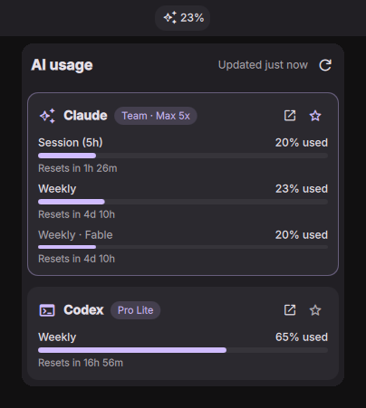

# Usage Bar

A [DankMaterialShell](https://github.com/AvengeMedia/DankMaterialShell) bar widget that shows how much of your
Claude and Codex subscription limits you've used.



## Install

```sh
git clone https://github.com/abdrakhmanovzh/usage-bar ~/.config/DankMaterialShell/plugins/UsageBar
~/.config/DankMaterialShell/plugins/UsageBar/install.sh
```

The script enables the plugin and adds it to your bar. Run `dms restart` if it doesn't show up.
To update, run `git pull` in that folder.

Requires `python3` and `jq`, and being logged in to `claude` and/or `codex`.

## Usage

- Click the bar item to see all limits and when they reset.
- ★ in the popout picks which subscription the bar shows.
- More options in DMS Settings → Plugins → Usage Bar.
- Keybind: `dms ipc call usageBar toggle`.

## How it works

It reads the login that Claude Code (`~/.claude/.credentials.json`) and Codex (`~/.codex/auth.json`) already
saved, and asks each provider's usage endpoint for your numbers. It never changes those files. If a login
expires, open `claude` or `codex` once and it refreshes.
